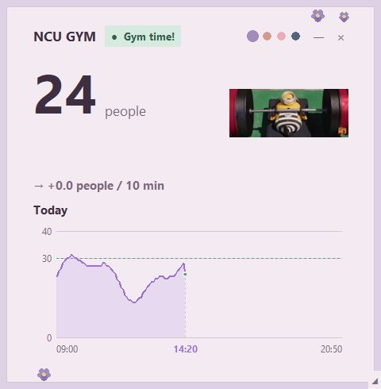

# NCU GYM Real-Time Monitor

**Live gym counts on your desktop. Check past crowd trends, pick a quieter hour, and crush your workout. 💪**\
**中央健人是否受夠人多炸的健身房了💀**\
**即時人數桌面顯示、歷史人數統計趨勢、讓你挑個舒服的一小時去健爆。 ## 要猛 !!**


## Preview

<table>
  <tr>
    <td align="center"><br><b>Midnight Monitor</b></td>
    <td align="center"><br><b>Morandi Violet</b></td>
  </tr>
</table>

*Small/full views are actual usage screenshots; theme previews use demo data. Widget: English · History dashboard: Traditional Chinese.*

## What it does

- Live count, GIFs, today's curve, and `people / 10 min` trends.
- Four themes, cross-monitor dragging, resizing, and optional Windows startup.
- Date-range analysis, weekday curves, comfort heatmap, and PNG export.

| Occupancy | Widget status | Animation folder |
|---|---|---|
| ≤30 people | `Gym time!` | `gif/low/` |
| 31–45 people | `fuwaa` (a little busy, but not crowded) | `gif/mid/` |
| ≥46 people | `Stay in lab` | `gif/high/` |
| No current reading | `No data` / connection status | `gif/close/` |


## Historical results


Each day has equal weight. Dashed line = 30 people.


Greener = more comfortable hours; stars = best observed starts. Historical results, not live forecasts; small samples are less reliable.

**Default comfort rule:** at least 90% of readings in a continuous 60-minute window are ≤30 people. Incomplete windows and gaps longer than five minutes are excluded.

Your crowd tolerance may be different. Find your own workout window with a custom threshold—for example, 40 people:

```powershell
python gym_analysis.py --threshold 40
```

This custom threshold applies to the command-line analysis; the dashboard and charts above currently use 30 people.

### Something cool..

- **Tuesday mornings aren't like other weekday mornings.** In my observations, they tend to be busier. University or college assembly periods might help explain this pattern, but that explanation hasn't been tested.
- **Weekend mornings aren't a guaranteed empty gym.** I often noticed a small rise around **10–11 a.m. on Saturdays**—something I had missed before looking at the data. So much for “just go on a weekend morning and have the place to yourself.” 💀

Crowd patterns may reflect more than opening hours: class schedules, campus routines, and even the question “when do I feel like lifting?” could all play a part. These are observations, not established causes. Have a theory? Open an issue and let's compare notes.

**中文觀察：** 週二早上相較其他平日早上，我觀察到人數較多，可能與校會、院週會等時段安排有關，但尚未驗證原因。週六早上 **10–11 點**也時常小幅增加，打破了我原本「假日早上去就能爽爽健」的想像。課表、校園作息，甚至大家心理上「幾點會想健一下」，都值得探討；歡迎開 issue 一起討論！也可以透過上方指令，自訂你能接受的人數門檻，找自己的舒服時段。

## Get started

**Windows · Python 3.10+ with Tkinter**

```powershell
git clone https://github.com/yao02201/NCU-GYM-Real-Time-Monitor.git
cd NCU-GYM-Real-Time-Monitor
python -m venv .venv
.\.venv\Scripts\python.exe -m pip install -r requirements.txt
.\.venv\Scripts\pythonw.exe gym.pyw
```

To see console output, run `.\.venv\Scripts\python.exe gym.py` instead. Keep this project folder in place after enabling launch at startup.

**Controls:** drag the content to move · drag an edge to resize · click a color dot to change theme · right-click for history, startup, and exit · `Esc` to close.

Open the history dashboard separately:

```powershell
.\.venv\Scripts\python.exe gym_dashboard.py
```

<details>
<summary>Development and customization</summary>

```powershell
python -m unittest discover -s tests -v
python gym_analysis.py --since 2026-03-21 --until 2026-04-10
python tools/preview_widget.py --theme midnight_monitor
python tools/render_readme_charts.py
```

Preview shortcuts: `F1`–`F4` change themes; `F5`–`F7` change sizes. Preview data and settings are isolated from the live widget.

New CSV logs, virtual environments, and Python caches are ignored by Git. Window and theme preferences are stored under `%LOCALAPPDATA%\NCUGymMonitor`.

</details>

## Future work

**From crowd history to a crowd forecast.** For now, this project displays live counts and analyzes past observations; it does **not** predict future occupancy.

- **Understand the surprises.** Holidays, long weekends, rain, temperature, cold snaps, and semester versus winter/summer-break routines may help explain why some days look nothing like the usual pattern. A next step is to collect these factors and analyze their relationships with occupancy. Correlation wouldn't prove causation—or guarantee better forecasts—but could reveal useful signals.
- **Forecast the next 1–2 hours.** Train and evaluate a model on later, unseen dates to estimate occupancy and the chance of a comfortable workout hour. If those signals improve accuracy, the goal is simple: help fellow lifters pick a time to train, not queue for equipment. 💪

**中文展望：** 目前只有即時人數與歷史統計，尚未提供預測。接下來希望納入假日、連假、降雨、氣溫、寒流，以及學期間與寒暑假的作息差異，先做相關性分析，探索讓人數變化難以預期的因素，再檢驗是否能改善預測。

長期希望訓練模型，預測未來 **1–2 小時**的人數與一小時內適合健身的機會，並用未參與訓練的後續日期驗證效果。讓各位中央健人再也不用搶器材、練到爽死——這才是終極目標！

Independent student project · Data: [NCU PE Office](https://pe.ncu.edu.tw/about/66.html) · Opening-hour filter: 09:00–20:50; closures follow official announcements. GIFs and character artwork belong to their respective creators.
