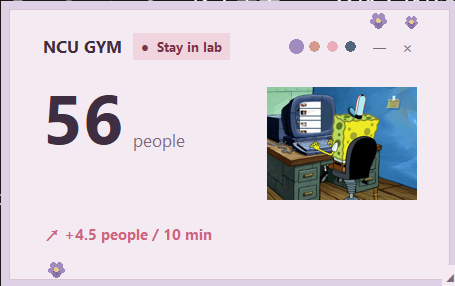
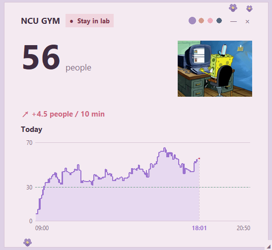

# NCU GYM Real-Time Monitor

**NCU gym packed again? 💀 Your workout shouldn't start with a queue.**

A tiny crowd radar for NCU lifters: live counts, animated reactions, and a quieter hour to train.

**各位中央健人是否受夠人多炸的健身房了💀**

即時看人數、看趨勢，挑個舒服的一小時再去健爆。

## Preview

<table>
  <tr>
    <td align="center" valign="top"><b>Small window</b><br></td>
    <td align="center" valign="top"><b>Full window</b><br></td>
  </tr>
</table>

Resize for a quick count or the full crowd curve.

<table>
  <tr>
    <td align="center"><br><b>Midnight Monitor</b></td>
    <td align="center"><br><b>Morandi Violet</b></td>
  </tr>
</table>

*Small/full views are actual usage screenshots; theme previews use demo data. Widget: English · History dashboard: Traditional Chinese.*

## What it does

- Live count, GIFs, today's curve, and `people / 10 min` trends.
- Four themes, cross-monitor dragging, resizing, and optional Windows startup.
- Date-range analysis, weekday curves, comfort heatmap, and PNG export.

| Occupancy | Widget status | Animation folder |
|---|---|---|
| ≤30 people | `Gym time!` | `gif/low/` |
| 31–45 people | `fuwaa` (a little busy, but not crowded) | `gif/mid/` |
| ≥46 people | `Stay in lab` | `gif/high/` |
| No current reading | `No data` / connection status | `gif/close/` |

Customize the folders with your GIFs or images. Each plays for **10 seconds**, then cycles to the next.

## Historical results


Each day has equal weight. Dashed line = 30 people.


Greener = more comfortable hours; stars = best observed starts. Historical results, not live forecasts; small samples are less reliable.

**Comfort rule:** at least 90% of readings in a continuous 60-minute window are ≤30 people. Incomplete windows and gaps longer than five minutes are excluded.

## Get started

**Windows · Python 3.10+ with Tkinter**

```powershell
git clone https://github.com/yao02201/NCU-GYM-Real-Time-Monitor.git
cd NCU-GYM-Real-Time-Monitor
python -m venv .venv
.\.venv\Scripts\python.exe -m pip install -r requirements.txt
.\.venv\Scripts\pythonw.exe gym.pyw
```

To see console output, run `.\.venv\Scripts\python.exe gym.py` instead. Keep this project folder in place after enabling launch at startup.

**Controls:** drag the content to move · drag an edge to resize · click a color dot to change theme · right-click for history, startup, and exit · `Esc` to close.

Open the history dashboard separately:

```powershell
.\.venv\Scripts\python.exe gym_dashboard.py
```

<details>
<summary>Development and customization</summary>

```powershell
python -m unittest discover -s tests -v
python gym_analysis.py --since 2026-03-21 --until 2026-04-10
python tools/preview_widget.py --theme midnight_monitor
python tools/render_readme_charts.py
```

Preview shortcuts: `F1`–`F4` change themes; `F5`–`F7` change sizes. Preview data and settings are isolated from the live widget.

New CSV logs, virtual environments, and Python caches are ignored by Git. Window and theme preferences are stored under `%LOCALAPPDATA%\NCUGymMonitor`.

</details>

Independent student project · Data: [NCU PE Office](https://pe.ncu.edu.tw/about/66.html) · Opening-hour filter: 09:00–20:50; closures follow official announcements. GIFs and character artwork belong to their respective creators.
