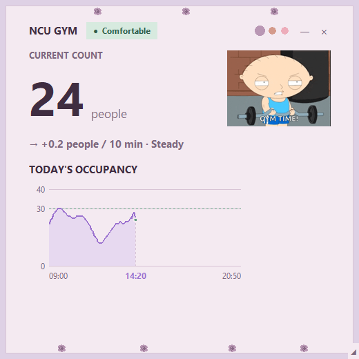
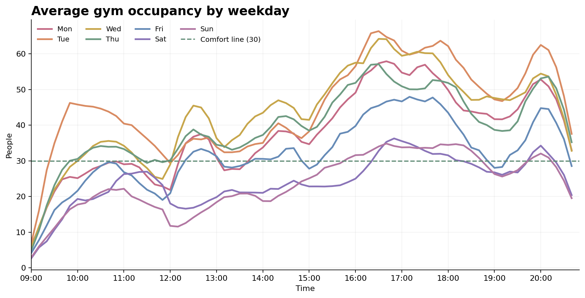
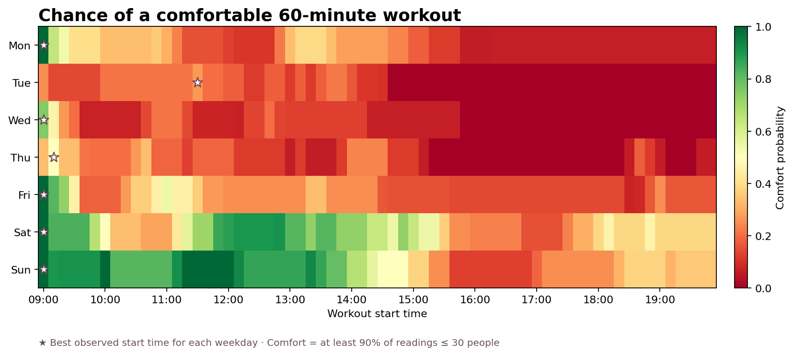

# NCU GYM Real-Time Monitor

中央大學健身房即時人數小工具與歷史分析介面。目標很簡單：**找出一天中適合舒服健身一小時的時段。**

> Live occupancy widget and historical dashboard for finding a comfortable one-hour workout window.

## 實際介面

<p align="center">
  
</p>

視窗可自由縮放：小尺寸只保留即時人數；放大後顯示 GIF、近期趨勢與當日折線圖。上方三個色點可切換主題。

## 統計結果展示

### 不同星期的人數走勢



虛線是 30 人舒適門檻。圖表以每天等權方式計算，避免資料較多的單一天過度影響結果。

### 舒適一小時機率



綠色代表該時段較常符合舒適條件，星號是目前資料中各星期表現最佳的開始時間。這是歷史觀測結果，不是未來預測。

## 主要功能

- 即時顯示重訓室人數，並依擁擠程度切換狀態與 GIF
- 可拖移、跨螢幕、自由縮放與縮到只剩人數
- 顯示當日人數折線、最新資料時間與 `people / 10 min` 趨勢
- 三種柔和配色與花朵裝飾
- 可設定 Windows 開機自動啟動
- 可選日期區間的互動式歷史分析
- 星期平均、舒適機率熱圖、每日平均與 P90
- 推薦各星期較適合的連續一小時

## 舒適時段定義

> 連續 60 分鐘內，至少 90% 的觀測值不超過 30 人。

資料不足、邊界缺漏或中斷超過五分鐘的時段不列入推薦。

## 安裝與執行

```bash
git clone https://github.com/yao02201/NCU-GYM-Real-Time-Monitor.git
cd NCU-GYM-Real-Time-Monitor
python -m pip install -r requirements.txt
python gym.py
```

Windows 使用者也可以執行 `gym.pyw`，啟動時不會顯示命令列視窗。

## 操作

- 拖曳內容：移動視窗
- 拖曳邊框：調整大小
- 點選色點：切換主題
- 滑鼠右鍵：開啟歷史分析或切換開機自啟
- `Esc`：關閉

歷史分析也可獨立執行：

```bash
python gym_dashboard.py
```

命令列分析：

```bash
python gym_analysis.py
python gym_analysis.py --since 2026-09-01 --until 2027-01-31
```

## 注意

- 官方例行開放時間為 09:00–20:50；臨時休館仍以體育室公告為準。
- 新產生的 CSV 預設只保留在本機，不會自動提交到 Git。
- 統計結果會隨累積資料與選擇日期區間而改變。
